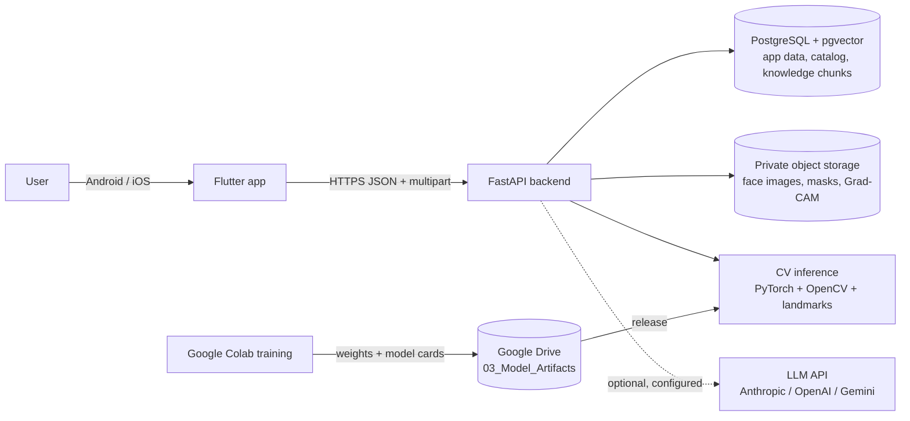
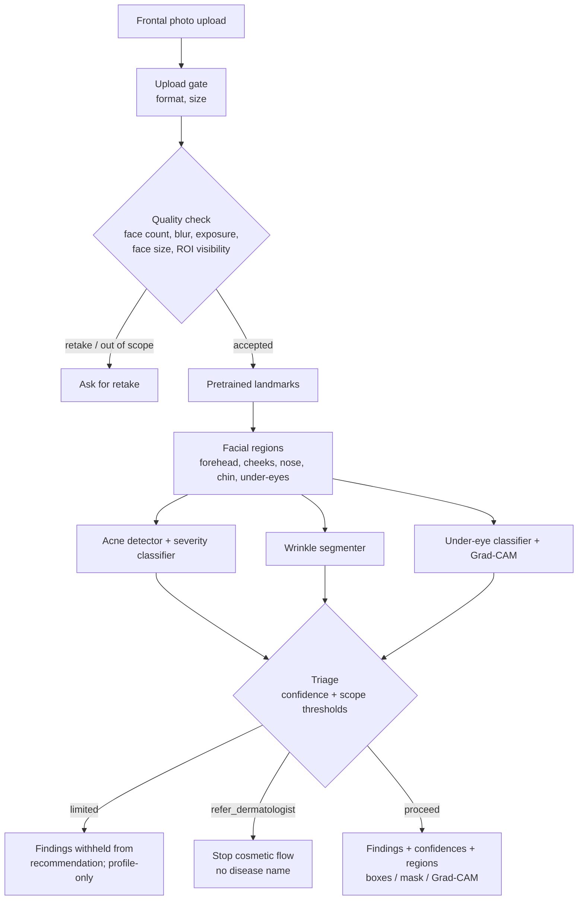
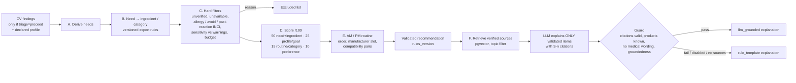
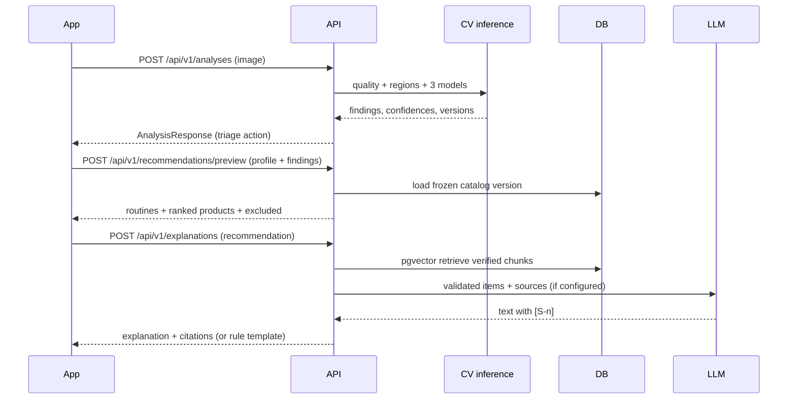

# Architecture

## System context

## What is trained, pretrained, rule-based or external

| Component | Kind | Code | Status |
|---|---|---|---|
| Acne lesion detection + 4-level severity | **Trained by us** (transfer learning from COCO / ImageNet) | `ml/training/configs.py` | Configs only; not trained |
| Wrinkle segmentation | **Trained by us** (U-Net, ImageNet encoder; weak → manual masks) | `ml/training/configs.py` | Configs only; not trained |
| Under-eye bag binary classification | **Trained by us** (ImageNet CNN) + Grad-CAM | `ml/training/configs.py` | Configs only; not trained |
| Face landmarks | **Pretrained** (e.g. MediaPipe), not retrained | adapter → `ml/preprocessing/face_regions.py` | Region geometry implemented; adapter pending |
| Image quality check | **Rule-based** (OpenCV metrics + thresholds) | `ml/preprocessing/quality.py` | Decision logic implemented; thresholds provisional |
| Triage / abstention | **Rule-based** | `backend/app/services/analysis/triage.py` | Implemented; thresholds provisional |
| Recommendation engine | **Rule-based**, deterministic | `backend/app/services/recommendation/` | Implemented; rule tables await expert review |
| RAG embeddings | **Pretrained** sentence-embedding model (configurable) | `backend/app/services/rag/embeddings.py` | Implemented (optional dependency) |
| RAG retrieval | pgvector cosine search | `backend/app/services/rag/store.py` | Implemented; knowledge base empty |
| Explanations / assistant | **External LLM API** (Anthropic / OpenAI / Gemini) | `backend/app/services/llm/` | Implemented; disabled by default |

We do **not** train an LLM, a recommendation model or an embedding model.
`GET /api/v1/system/components` returns this table plus the active configuration.

## Analysis pipeline

`ANALYSIS_BACKEND=mock` (default) runs labelled placeholder models (`is_mock=true`, `model_version=mock-0`) through the
same quality → regions → triage path. Real inference (`torch`) is a separate backend that loads registered weights; mock
code and demo data never mix with it.

## Recommendation + explanation pipeline

Authority order: **hard filters & scores (rules) > retrieved verified sources > LLM wording.** The LLM receives only
products that passed the filters and cannot add, remove or re-rank them. RAG supplies evidence; it never filters
products (exact filtering is SQL + rules). If no verified source is retrieved, the LLM is not called.

## Typed contracts

| Boundary | Contract |
|---|---|
| Flutter ↔ FastAPI | `docs/API_SPEC.yaml`; Pydantic schemas in `backend/app/schemas/`; Dart mirrors in `mobile/lib/core/models.dart` |
| FastAPI ↔ CV inference | `ml/inference/interfaces.py` (`AcneDetector`, `WrinkleSegmenter`, `UnderEyeClassifier`) |
| Analysis → recommendation | `FindingsIn` (incl. `triage_action`, `is_mock`) |
| Recommendation → explanation | `RecommendationResponse` sent unchanged in `ExplanationRequest` |
| Business logic ↔ LLM | `LLMProvider.generate(LLMRequest) -> LLMResponse` (`backend/app/services/llm/base.py`) |
| Business logic ↔ vector DB | `Embedder`, `VectorStore`, `Retriever` (`backend/app/services/rag/`) |

## Repository mapping

| Path | Contents |
|---|---|
| `backend/app/services/analysis/` | upload gate, mock pipeline, triage |
| `backend/app/services/recommendation/` | `rules.py`, `engine.py`, `routine.py` |
| `backend/app/services/rag/` | documents + chunking, embeddings, in-memory / pgvector stores, retriever, citations |
| `backend/app/services/llm/` | provider interface, Anthropic / OpenAI / Gemini adapters, guard, explain, provider comparison |
| `backend/app/models/knowledge.py` | `knowledge_documents`, `knowledge_chunks` (vector), `llm_call_logs` |
| `ml/preprocessing/` | quality check, facial regions |
| `ml/training/` | transfer-learning configs per task |
| `ml/inference/` | task interfaces, labelled mocks |
| `ml/evaluation/` | mAP, macro-F1, QWK, Dice/IoU, F1, ROC-AUC (pure Python) |

## Key decisions

1. **Server-side inference**: reduces device load and compatibility issues.
2. **Framework-free ML contracts** so backend and tests run without torch.
3. **Rules, not ML or LLM, choose products**: auditable and reproducible (`rules_version` + `catalog_version`).
4. **Provider-independent LLM layer**: same prompt, guard and metrics for every provider; comparisons change config, not code.
5. **pgvector inside PostgreSQL** as the starting vector store (one database to operate); swappable via `VectorStore`.
6. **Images never stored in PostgreSQL**: metadata + object-storage key with expiry.
7. **Separate provenance**: image findings and declared data kept apart so each recommendation is traceable.

## Sequence: analyse, recommend, explain

