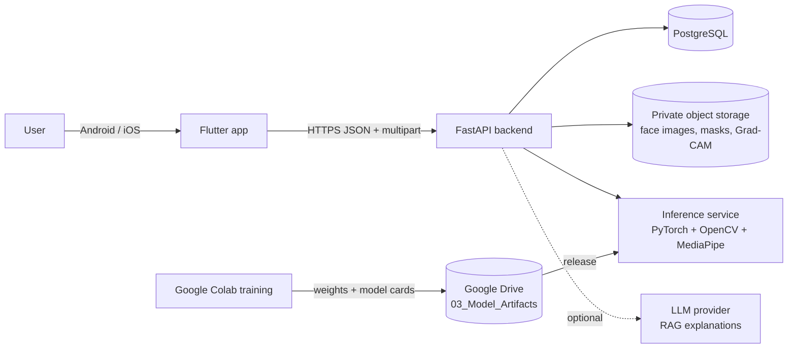
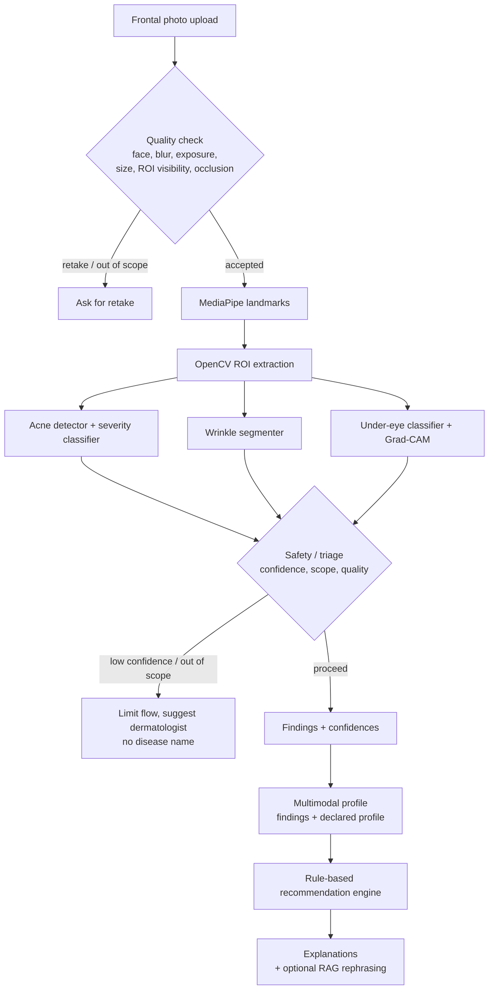
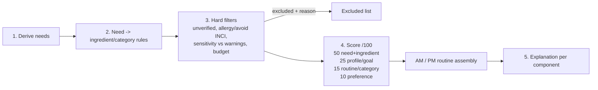
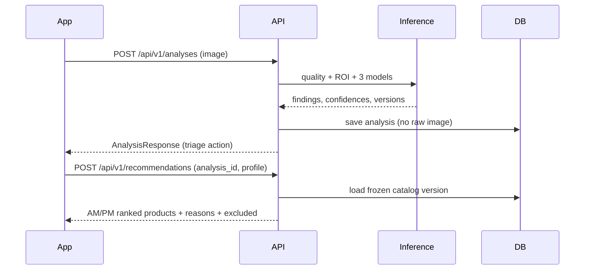

# Architecture

## System context

## Analysis pipeline

## Recommendation engine

Deterministic: pinned `rules_version` + `catalog_version` ⇒ reproducible output.

## Components and repository mapping

| Component | Path | Tech | Status |
|---|---|---|---|
| Mobile app | `mobile/` | Flutter, go_router, http | Navigation + placeholder screens |
| API | `backend/app` | FastAPI, Pydantic v2 | `/health`, mock analysis, recommendation preview |
| Data model | `backend/app/models`, `database/migrations` | SQLAlchemy 2, Alembic | Initial schema (`0001`) |
| ML contracts | `ml/inference/interfaces.py` | Pure Python Protocols | Done |
| Mock models | `ml/inference/mock_models.py`, `backend/app/services/mock_analysis.py` | — | Labeled `mock-0`, `is_mock=true` |
| Quality check | `ml/preprocessing/quality.py` | OpenCV, MediaPipe | Contract only |
| Training | `ml/training`, `ml/notebooks` | PyTorch on Colab | Not started |
| LLM/RAG | `backend/app/services/llm.py` | Provider interface | Disabled stub |
| CI | `.github/workflows/ci.yml` | GitHub Actions | Lint, migrations, tests |

## Key decisions

1. **Server-side inference** (proposal): reduces device load and device-compatibility issues.
2. **Framework-free ML contracts** so backend and tests run without torch; real models plug in behind `ANALYSIS_BACKEND=torch`.
3. **Rules, not ML, choose products**: auditable and reproducible; LLM may only rephrase.
4. **Images never stored in PostgreSQL**: only metadata and an object-storage key with expiry.
5. **Separate provenance**: image-derived findings and user-declared data stored in separate fields so each recommendation is traceable to its source.

## Sequence: analyse and recommend

