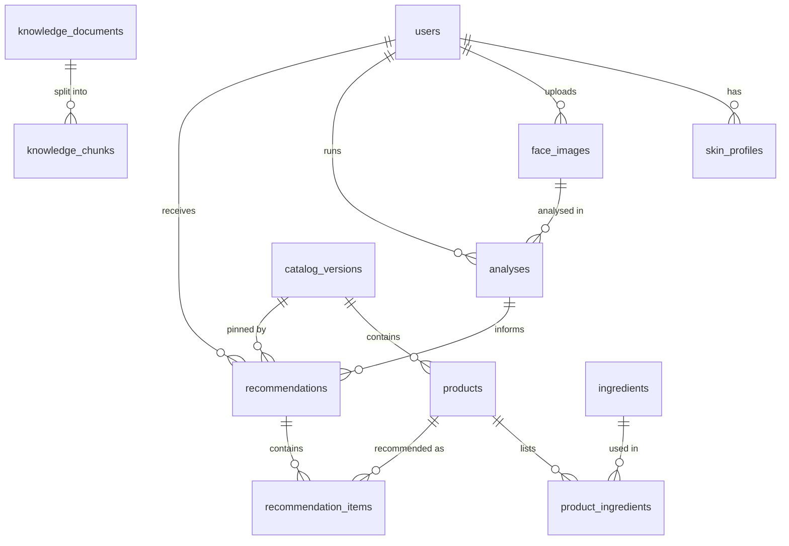

# Database Schema

PostgreSQL 16 · SQLAlchemy 2 models in `backend/app/models/entities.py` · migrations `0001_initial_schema.py`, `0002_rag_knowledge_llm_logs.py`, `0003_profile_past_reaction_ingredients.py` (`database/migrations/versions/`). Requires the **pgvector** extension (`pgvector/pgvector:pg16` image).



## Tables

### users
| column | type | notes |
|---|---|---|
| id | uuid PK | |
| email | varchar(320) unique | |
| password_hash | varchar(255) | argon2/bcrypt; never plain |
| is_active | bool | |
| consent_version, consent_at | varchar, timestamptz | privacy-notice version accepted |
| deleted_at | timestamptz | soft delete → hard purge job |
| created_at | timestamptz | |

### skin_profiles (user-declared; NULL = unknown, never "no")
| column | type | notes |
|---|---|---|
| id | uuid PK | |
| user_id | uuid FK users (cascade) | |
| skin_type | varchar(16) | dry / oily / combination / normal |
| sensitivity | varchar(16) | none / mild / high |
| allergies, avoid_ingredients | json | INCI names |
| goals | json | acne_care, wrinkle_care, under_eye_care, hydration, sun_protection |
| current_routine | json | |
| past_reactions | text | free text |
| past_reaction_ingredients | json | INCI linked to past adverse reactions; hard-excluded |
| budget_max, currency | numeric(10,2), char(3) | |
| preferences | json | categories, texture, etc. |

### face_images (metadata only)
id, user_id, storage_key (private bucket), sha256, width, height, quality_status (accepted/retake/out_of_scope), quality_reasons json, expires_at, created_at.

### analyses
id, user_id, face_image_id (FK, set null), status (completed/limited/referred/failed), **is_mock**, acne json, wrinkles json, under_eye json, triage json, model_versions json, created_at.

### catalog_versions
id, label (unique, e.g. `2026.12-v1`), frozen bool, notes. A frozen version is immutable; the A/B/C study pins one.

### ingredients
id, inci_name (unique, CosIng-normalised), cosing_ref, functions json.

### products
id, catalog_version_id, barcode, brand, manufacturer, name, category, routine_slot (am/pm/both — manufacturer instruction), intended_use, usage_instructions, targets json (needs, from reviewed rules), suitable_skin_types json, warnings json, price, currency, price_checked_at, available, availability_note, discovery_url (e.g. Open Beauty Facts — discovery only), source_url + source_type (manufacturer / package — authoritative verification source), accessed_at, verified_at, verification_status (pending/verified/rejected), created_at.

### product_ingredients
PK (product_id, ingredient_id), position (INCI order), is_key.

### recommendations
id, user_id, analysis_id, catalog_version_id, rules_version, mode (profile_only / image_only / multimodal), needs json, explanation, created_at.

### recommendation_items
id, recommendation_id, product_id, routine_slot, step_order, total_score, score_breakdown json (`need_ingredient`, `profile_goal`, `routine_category`, `preference`), reasons json.

### knowledge_documents (RAG sources)
id, title, source_type (scientific / dermatology_guideline / ingredient_db / manufacturer / regulatory), source_url, publisher, accessed_at, license, verification_status (only `verified` is retrieved), language, topics json (needs / INCI used as retrieval filters), created_at.

### knowledge_chunks
id (`<doc_id>#<n>`), document_id, position, text, embedding `vector(384)` (HNSW, cosine), embedding_model. Changing the embedding dimension requires a migration and re-embedding.

### llm_call_logs (metrics only — no prompt text, no user ids)
id, created_at, purpose, provider, model, mode (llm_grounded / rule_template), fallback_reason, latency_ms, input_tokens, output_tokens, est_cost_usd, grounded_ratio, safe, rules_version.

## Catalog verification workflow

1. Candidate from Open Beauty Facts (record ODbL attribution) → `pending`.
2. Compare INCI with manufacturer official page / technical doc / packaging; manufacturer wins; log differences.
3. Normalise INCI via CosIng; store functions.
4. Complete all required fields → `verified` (with `verified_at`); otherwise `rejected`.
5. Freeze catalog version (≥ 100 verified) before A/B/C scenarios. Current status: no product records yet.

Knowledge base: rows prepared from `database/seed/knowledge_template.csv`; a person verifies the source and that its licence permits storing excerpts before `verified`; ingestion rejects anything else.

## Commands

```bash
cd backend && export PYTHONPATH=$PWD:$PWD/..
alembic upgrade head                         # apply
alembic revision --autogenerate -m "msg"     # new migration (review before commit)
alembic check                                # model/migration drift
alembic downgrade -1
```
